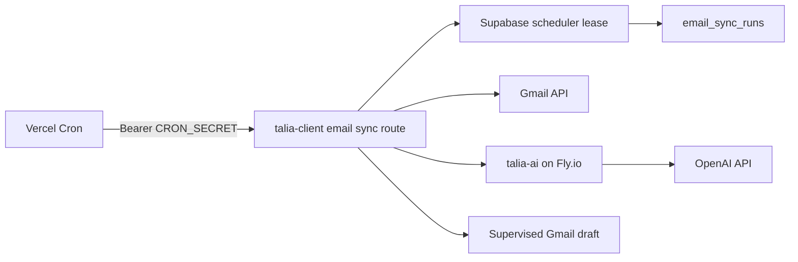

# Production Email Scheduler and CASA Evidence

Owner: TALIA engineering and security  
Control: CASA-038  
Last reviewed: 24 July 2026

## Purpose

This runbook explains how TALIA deploys, operates and audits the supervised
email scheduler across Vercel, Supabase and `talia-ai` on Fly.io. It is intended
for engineers joining the team and for operators preparing CASA evidence.

This document contains no credentials or customer email data. CASA screenshots,
logs and exports belong in the restricted company security workspace, not in
the repository or a general-purpose Notion page.

## System boundary



Boundary rules:

- OAuth access and refresh tokens remain inside the trusted `talia-client`
  server boundary.
- `talia-ai` never receives OAuth tokens.
- TALIA creates drafts; it does not send email automatically.
- Logs contain stable event names, run IDs, durations and counters only.
- Message bodies, subjects, sender addresses, OAuth metadata and AI payloads
  must not be exported as operational evidence.

## Production components

| Component | Platform | Responsibility |
| --- | --- | --- |
| `talia-client` | Vercel | OAuth, Gmail synchronization, durable scheduler and supervised drafts |
| `talia-ai` | Fly.io | Email classification and draft generation |
| Supabase | Managed Postgres | Encrypted connection metadata, email state, leases and durable run records |
| Vercel Cron | Vercel | Authenticated invocation every 15 minutes |

The registered route is `GET /api/cron/email/sync` with schedule
`*/15 * * * *`.

## Access and change-risk model

### Read-only: no production mutation

These operations may be used for diagnosis when the operator has legitimate
access:

- inspect Git SHAs and clean working trees;
- inspect Vercel deployments and aliases;
- inspect Fly releases, machine state, region and `/health`;
- read sanitized scheduler counters from `email_sync_runs`;
- inspect migration history;
- inspect security response headers.

Read-only access still follows least privilege. Do not query email content,
addresses, OAuth metadata or encrypted token fields merely because a service
credential makes that technically possible.

### Controlled production execution

These operations create operational records or contact external providers and
must be announced before execution:

- invoking the email cron;
- claiming and finishing a scheduler run;
- synchronizing a controlled mailbox;
- testing OAuth refresh, draft creation, disconnect or revocation.

Use a dedicated test mailbox and record the purpose, operator, timestamp and
expected effect. Export only sanitized results.

### Production changes requiring explicit approval

Do not perform these operations without explicit approval from the responsible
owner:

- applying a Supabase migration;
- rotating `CRON_SECRET`, `INTERNAL_API_KEY`, encryption keys or OAuth secrets;
- changing RLS, grants, roles or service-role access;
- deploying or promoting a release;
- changing Vercel cron frequency;
- enabling a mailbox or broadening the canary population;
- deleting or replaying production email state.

Before approval, state the target system, exact change, affected data,
reversibility, expected result and verification plan.

## Safe migration procedure

1. Create a forward-only migration. Never edit a migration already applied in
   production.
2. Add a regression test that reproduces the production failure.
3. Reset the local Supabase database and apply the complete migration history.
4. Run pgTAP, application tests, lint, typecheck and build.
5. Open a PR against `develop` and require green protected CI.
6. Confirm the approved commit is present in the intended branch.
7. Run a production dry run:

   ```bash
   supabase db push --linked --dry-run
   ```

8. Review the exact pending migration list. Stop if any unrelated migration is
   present.
9. Obtain explicit approval.
10. Apply:

    ```bash
    supabase db push --linked
    ```

11. Confirm local and remote migration versions match.
12. Execute the narrowest possible functional verification and retain
    sanitized evidence.

For `CREATE OR REPLACE FUNCTION` changes, rollback is another forward migration
that restores the previously approved function definition. Do not roll back to
a definition already known to be defective.

## Scheduler execution model

Each authorized invocation:

1. validates the Vercel bearer credential;
2. obtains a Postgres advisory lock;
3. expires a stale lease if necessary;
4. creates one durable `email_sync_runs` row;
5. lists only connections due for polling;
6. synchronizes provider message IDs idempotently;
7. classifies eligible messages and creates supervised drafts;
8. finishes the durable run with sanitized counters.

Only one run may have `status = 'running'`. A second delivery is skipped while a
lease is active. Provider message and thread constraints prevent duplicate
imports when Vercel delivers the same schedule more than once.

## CASA-038 verification

Use a controlled Gmail account and verify:

1. Vercel production aliases resolve to the approved deployment.
2. The cron route and 15-minute schedule are visible.
3. `email_sync_started` contains a sanitized `run_id`.
4. The corresponding `email_sync_runs` row reaches `succeeded`, `partial` or
   `failed` and has `completed_at`.
5. A second no-change execution imports no duplicate messages.
6. Fly reports the expected release, `cdg` region and a passing health check.
7. `https://talia-ai.fly.dev/health` returns `200` with the expected security
   headers.
8. CI for both repositories is green on the deployed baseline.

Permitted evidence query:

```sql
select
  id,
  status,
  started_at,
  completed_at,
  checked_count,
  synced_count,
  failed_count,
  imported_count,
  skipped_count,
  inspected_count,
  processed_count,
  error_code
from public.email_sync_runs
where id = '<run-id-from-sanitized-logs>';
```

Never add `email_connections`, `email_threads`, `email_messages`,
`oauth_metadata`, subjects, bodies or addresses to the evidence query.

## Evidence checklist

- Vercel production deployment, aliases and date.
- Vercel Pro plan and cron configuration.
- Sanitized scheduler logs.
- Sanitized `email_sync_runs` export for the same run ID.
- Green CI for `talia-client`.
- Fly release, image digest, region and health response.
- Green CI for `talia-ai`.
- Second-person review with reviewer and date.

Store each artifact in the restricted security workspace with the CASA control
number. A runbook or database row alone is not approval evidence.

## Known traceability limitations

- A Vercel redeployment may not expose `gitSource` in `vercel inspect`. Retain
  the original Git-triggered deployment or CI record that maps the deployment
  to an immutable SHA.
- The current Fly image does not expose an
  `org.opencontainers.image.revision` label. Add the source SHA as an OCI image
  label or Fly release annotation so future releases can be mapped directly
  from Fly without relying on deployment timing.
- Vercel log export may lag or omit an application completion event. The
  durable database row remains the source of truth for run completion, but the
  missing log event must be recorded rather than reconstructed.

## Incident response

- `401`: verify secret presence and deployment scope. Never print the secret.
- `email_sync_claim_failed`: stop repeated invocation and inspect the scheduler
  function and migration state.
- `run_already_active`: inspect the sanitized active run and lease time; do not
  force a second run.
- `lease_expired`: investigate the interrupted execution before retrying.
- provider or AI failure: use stable error codes and request IDs. Never paste
  raw provider responses into tickets or chat.
- suspected credential exposure: stop testing, rotate the affected credential,
  review logs and follow the incident-response runbook.

Related documents:

- `docs/operations/email-agent-canary.md`
- `docs/security/casa-readiness.md`
- `docs/security/incident-response.md`
- `docs/operations/git-sync-workflow.md`
