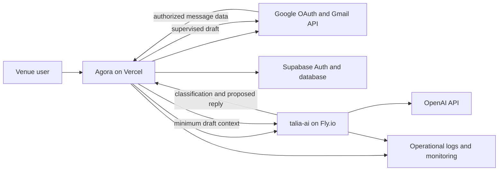

# CASA readiness for Google restricted scopes

Owner: TALIA engineering and security  
Tracking issue: TAL-35  
Last reviewed: 19 July 2026

Google Cloud project: `talia-496121` (`299067760624`)  
Assigned assessment: **CASA Tier 2 Authorized Lab Scan**  
Google deadline: **19 September 2026**

## Purpose

This is the evidence index and gap register for TALIA's Google restricted-scope
verification and Cloud Application Security Assessment (CASA). It does not
claim certification. Google has assigned Tier 2; a CASA authorized laboratory
must validate the applicable controls and issue the assessment letter required
to resume Google's verification.

TALIA requests:

- `https://www.googleapis.com/auth/gmail.readonly` to inspect authorized inbound
  messages that may require a response;
- `https://www.googleapis.com/auth/gmail.compose` to create supervised Gmail
  drafts without permission to send them.

Both scopes are required by the implemented workflow. TALIA deliberately does
not request full Gmail access or a scope that permits automatic sending.

## System boundary

Security boundary rules:

- OAuth access and refresh tokens stay in `talia-client` and are never sent to
  `talia-ai` or OpenAI.
- Tokens are encrypted with AES-256-GCM before persistence in
  `email_connections.oauth_metadata`.
- OAuth state is signed, expires after ten minutes, and is bound to the initiating
  TALIA user and venue.
- `talia-ai` receives only the message context required to classify and draft.
- The Gmail integration creates drafts. A human remains responsible for sending.
- Disconnect revokes Google access where possible and prevents future sync.

## Readiness matrix

Status values: **verified**, **partial**, **gap**, **external**.

| Area | Status | Current evidence | Required action |
| --- | --- | --- | --- |
| Restricted-scope minimization | verified | `GOOGLE_GMAIL_SCOPES` in `src/lib/email/google-oauth.ts` | Capture Cloud Console scope screenshot and written justification. |
| OAuth CSRF protection | verified | Signed, expiring state plus callback user/venue binding; unit tests | Retain CI result and production callback test record. |
| Token confidentiality at rest | verified | AES-256-GCM and dedicated secret enforcement; unit tests | Record production secret presence and rotation owner without exposing values. |
| Token refresh | partial | Refresh and encrypted persistence in `src/lib/email/google-tokens.ts` | Add an integration test using a controlled Google test mailbox. |
| Disconnect and revocation | partial | Product action and Google revoke helper exist | Capture end-to-end evidence and confirm local data disposition. |
| Retention and deletion | partial | `docs/operations/data-retention.md` and database job | Run production dry run and deletion, retain timestamp and row counts. |
| Tenant authorization and RLS | partial | `docs/security/authorization-model.md`, membership checks and RLS | Perform and document a full cross-tenant access test. |
| Authentication | partial | Email verification, password policy and Supabase Auth | Verify production settings; add MFA for privileged operators or document assessor-approved compensating controls. |
| Abuse and rate limiting | gap | Process-local auth limiter only | Move public and sensitive endpoint limits to shared infrastructure/WAF. |
| Browser security headers | partial | Frame, MIME, referrer and permissions headers | Add and test CSP and production HSTS without breaking the embeddable widget. |
| Dependency security | verified | CI `security:audit`; production audit reports zero known vulnerabilities on this baseline | Enable automated update alerts and archive CI output for the assessment. |
| Logging and redaction | partial | Structured operational logs; tokens are not intentionally logged | Audit every Gmail/OAuth error path and prove message bodies/tokens are redacted. |
| Internal support access | partial | Platform authorization and audit events | Define approval, time bounds and review for any human access to Gmail-derived data. |
| Incident response | gap | No assessor-ready runbook in this repository | Document severity, containment, notification, recovery and postmortem ownership. |
| Vulnerability management | partial | CI audit and normal issue workflow | Define intake, severity SLA, remediation evidence and disclosure contact. |
| Backup and recovery | gap | Provider-managed capabilities not evidenced here | Document Supabase/Vercel/Fly backup, restore and recovery tests. |
| Privacy and Limited Use | partial | Public English privacy policy and retention policy | Verify deployed URLs/text and legal approval against the production data flow. |
| Production/staging separation | external | Recommended in Google OAuth operations guide | Verify separate Google Cloud projects and remove non-production clients from the production project. |
| CASA Tier 2 validation | external | Google assignment email for project `talia-496121` | Onboard with TAC or another authorized lab, complete its Tier 2 scan, remediate findings and obtain the assessment letter before 19 September 2026. |

## Evidence package

Store evidence in the restricted company security workspace, not in the public
repository. Use stable names so each annual reassessment can be compared.

1. Asset inventory: domains, Google Cloud project IDs, OAuth client IDs,
   Supabase project, Vercel project and Fly.io application. Do not include secrets.
2. Current architecture and data-flow diagram, including every processor that
   receives Gmail-derived content.
3. Scope justification and screenshots from Google Auth Platform Branding,
   Audience, Clients and Data Access.
4. Public home, privacy and terms URLs as deployed.
5. CI evidence: immutable commit SHA, typecheck, lint, tests and dependency audit.
6. OAuth evidence: connect, consent, read, supervised draft, token refresh,
   disconnect, Google revocation and rejected replay/tampered state.
7. Authorization evidence: venue member success, unauthorized venue denial,
   platform support access and audit events.
8. Retention evidence: dry run, real deletion, deletion request and confirmation
   that sync stops after disconnect.
9. Operational evidence: secret rotation, incident response, restore exercise,
   vulnerability remediation and approved human-access procedure.
10. Assessor communications, findings, remediation records, retest result and
    final Letter of Validation.

## Google verification video script

Record in English against the production OAuth client with a dedicated test
mailbox. Keep the browser address bar and OAuth client identity visible.

1. Open TALIA's public home page, privacy policy and terms.
2. Sign in to Agora and open the Email Agent for an authorized venue.
3. Select **Connect Google**, show the TALIA app name and requested scopes on the
   Google consent screen, and grant access.
4. Return to Agora and show the connected mailbox identity.
5. Synchronize a controlled inbound message and show why `gmail.readonly` is
   necessary for classification.
6. Generate a supervised draft, open it in Gmail and show why `gmail.compose` is
   necessary. Do not send it automatically.
7. Disconnect Gmail in TALIA, show that future sync is disabled, and show the
   corresponding revocation/deletion behavior.

## Execution order

1. Register project `talia-496121` with TAC Security using the Tier 2 option and
   provide Google's assignment email and deadline.
2. Confirm TAC's scope, target URLs, test account requirements, evidence list,
   retest policy, delivery dates and exact assessment-letter submission process.
3. Close every **gap** and turn every **partial** row into reproducible evidence
   while TAC prepares or runs the authorized scan.
4. Provide TAC with a dedicated least-privilege test account and production-like
   environment that exercises the complete restricted-scope workflow.
5. Remediate every finding, submit fixes for retest and obtain the Tier 2
   assessment letter with enough margin before 19 September 2026.
6. Reply directly to Google's Third Party Data Safety Team email with the letter
   or the delivery mechanism specified by TAC, then verify the status in Google
   Cloud Verification Center.
7. Record the validation date and schedule annual recertification.

## Official references

- Google restricted-scope verification:
  https://developers.google.com/identity/protocols/oauth2/production-readiness/restricted-scope-verification
- Google security assessment overview:
  https://support.google.com/cloud/answer/13465431
- App Defense Alliance CASA:
  https://appdefensealliance.dev/casa
